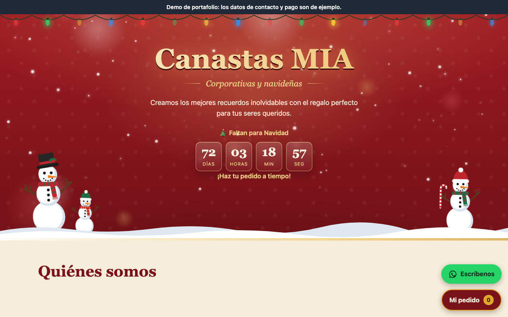
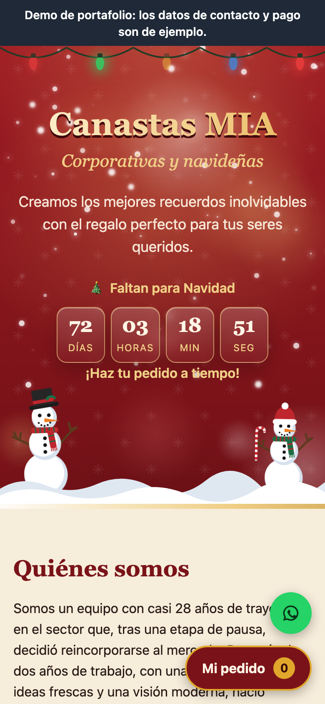

# Catálogo Navideño Canastas MIA

Catálogo web para un negocio real de canastas navideñas y corporativas en Lima. Los clientes ven
las canastas, arman su pedido y lo envían por WhatsApp.

**[Ver la demo en vivo](https://juancarlosmendiolamorales-ui.github.io/catalogo-canastas-navidad/)** ·
[Biblioteca de temas](https://juancarlosmendiolamorales-ui.github.io/catalogo-canastas-navidad/temas/)

> Esta es la versión de portafolio. Los teléfonos, correo y cuentas de pago son de ejemplo.

  
  

## Qué hace

- **Pedido por WhatsApp:** el cliente elige canastas y cantidades, llena sus datos y método de pago,
  y la página arma el mensaje del pedido listo para enviar.
- **Precios editables desde Google Sheets:** la dueña cambia nombre, productos, precio, orden o
  visibilidad de cada canasta en una hoja de cálculo, sin tocar código. Si la hoja no se puede leer,
  la página usa los datos que trae guardados.
- **Carrito que se guarda** en el navegador (`localStorage`), así el pedido no se pierde al recargar.
- **El tema cambia solo según la fecha** (hora de Lima): Navidad, Mes morado, Halloween, Fiestas
  Patrias, San Valentín, Día de la Madre y un tema clásico para el resto del año. Cada uno tiene su
  decoración animada, su pantalla de carga y su cuenta regresiva. Se pueden ver todos con `?tema=`:
  [navidad](https://juancarlosmendiolamorales-ui.github.io/catalogo-canastas-navidad/?tema=navidad) ·
  [halloween](https://juancarlosmendiolamorales-ui.github.io/catalogo-canastas-navidad/?tema=halloween) ·
  [patrias](https://juancarlosmendiolamorales-ui.github.io/catalogo-canastas-navidad/?tema=patrias) ·
  [sanvalentin](https://juancarlosmendiolamorales-ui.github.io/catalogo-canastas-navidad/?tema=sanvalentin) ·
  [madre](https://juancarlosmendiolamorales-ui.github.io/catalogo-canastas-navidad/?tema=madre) ·
  [morado](https://juancarlosmendiolamorales-ui.github.io/catalogo-canastas-navidad/?tema=morado) ·
  [clasico](https://juancarlosmendiolamorales-ui.github.io/catalogo-canastas-navidad/?tema=clasico)
- **Animaciones con CSS y JavaScript puro:** partículas generadas con profundidad (nieve, pétalos,
  confeti, luciérnagas), paralaje con el mouse, títulos con brillo, cuenta regresiva de vidrio y
  fuegos artificiales. Respeta la opción "reducir movimiento" del sistema.
- **Diseño responsive** y accesible: funciona en celular, con etiquetas para lectores de pantalla.
- **Un solo archivo**: las imágenes van incrustadas, así se puede compartir o subir en cualquier lado.

## Tecnologías

HTML, CSS y JavaScript sin frameworks · Google Sheets (lectura en CSV) · WhatsApp (`wa.me`) ·
GitHub Pages

## Qué aprendí

- Leer y procesar un CSV en JavaScript (comillas, comas dentro de campos, saltos de línea).
- Separar los datos del diseño para que una persona sin conocimientos de programación pueda
  actualizar el catálogo.
- Diseñar pensando primero en el celular, que es desde donde compran los clientes.
- Trabajar con un cliente real: cambios de precios, fotos y temas según la temporada.
- Animar sin librerías: keyframes con variables CSS, partículas generadas por JavaScript y
  propiedades `translate`/`scale` independientes para combinar movimientos sin que choquen.

Hecho con ayuda de [Claude Code](https://claude.com/claude-code) como asistente de programación.

## Autor

**Juan Carlos Mendiola**, estudiante de Ingeniería de Sistemas en la UPC.
